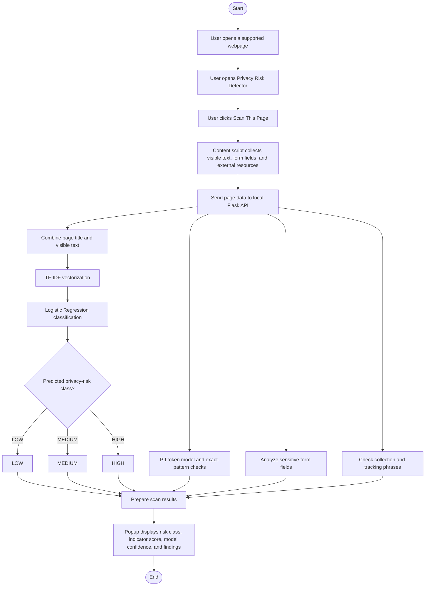
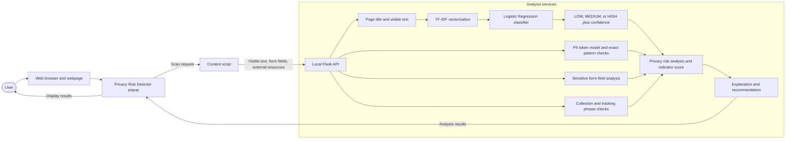

# Privacy Breach and PII Detection in Web Browsing

## 1. Project Overview

This capstone project is a browser extension designed to detect potential privacy risks on webpages.

The system extracts webpage content, identifies privacy-related information, and uses a machine learning model to classify the webpage into three privacy-risk categories:

* 🟢 Low Risk
* 🟡 Medium Risk
* 🔴 High Risk

The extension also runs a separate token-level PII detector trained from
character-span annotations. It reports grouped detections without displaying
the matched values. The risk classifier and PII detector are separate models.

The machine learning component uses:

* TF-IDF Vectorization
* Logistic Regression Classification
* Token-level PII detection with hashed token features and SGD classification

The browser extension uses JavaScript to extract webpage text and communicates with a Python API that performs the machine learning prediction.

---

## 2. Process Flow Chart



### Architectural Framework Diagram



---

## 3. Technologies

### Machine Learning

* Python
* Pandas
* Scikit-learn
* TF-IDF
* Logistic Regression
* FeatureHasher
* SGDClassifier
* Joblib

### Backend

* Flask
* Flask-CORS
* Python

### Browser Extension

* JavaScript
* HTML
* CSS
* Chrome Extension Manifest V3

---

## 4. Project Structure

```text
baby-caps/
│
├── dataset/
│   ├── privacy_dataset.csv
│   └── pii-masking-200k.csv
│
├── model/
│   ├── privacy_model.pkl
│   ├── tfidf_vectorizer.pkl
│   └── pii_entity_model.pkl
│
├── extension/
│   ├── manifest.json
│   ├── content.js
│   ├── popup.html
│   ├── popup.js
│   └── style.css
│
├── train_model.py
├── train_pii_model.py
├── pii_detection.py
├── app.py
├── README.md
└── README_USAGE.md
```

---

## 5. Components Created

### `dataset/privacy_dataset.csv`

Contains examples for the three-class webpage risk classifier.

The dataset currently contains three labels:

```text
0 = Low Risk
1 = Medium Risk
2 = High Risk
```

The prototype dataset contains 90 samples, with 30 samples per class. The
`source` column identifies the original starter rows and added synthetic rows.

> Note: Most rows are synthetic examples for development. Review them and
> collect independently labeled, representative data before making final
> performance claims.

The separate `dataset/pii-masking-200k.csv` dataset provides token and
character-span annotations for the PII detector. It is a different task and
does not provide LOW/MEDIUM/HIGH risk labels.

---

### `train_model.py`

Trains the three-class webpage risk classifier using
`dataset/privacy_dataset.csv`, TF-IDF features, and Logistic Regression.

Main process:

```text
Load CSV
   ↓
Separate text and labels
   ↓
TF-IDF Vectorization
   ↓
Train Logistic Regression
   ↓
Evaluate Model
   ↓
Save Model
   ↓
Save TF-IDF Vectorizer
```

The trained files are saved as:

```text
model/privacy_model.pkl
model/tfidf_vectorizer.pkl
```

The optional `source` column in the CSV records whether a row is a starter or
synthetic example; the trainer uses only the `text` and `label` columns.

### `train_pii_model.py`

Trains a token-level detector from `pii-masking-200k.csv` and saves
`model/pii_entity_model.pkl`. It uses annotated character spans, streams
training batches, skips invalid offsets, and reports held-out token precision,
recall, and F1. These are token-level metrics, not whole-entity or real-webpage
accuracy. Run it with `python train_pii_model.py`.

---

### `app.py`

Provides the local Flask API used by the extension.

The extension uses:

```text
POST /analyze
```

It accepts page title, visible text, form metadata, and external-resource
metadata. The separate `POST /predict` route accepts text and returns the risk
classification, confidence, and class probabilities. `GET /` reports API
health and loaded model names.

The `/analyze` response includes the risk label, indicator score, model
confidence and class probabilities, form fields, privacy-indicator matches,
PII detections, explanations, and a recommendation. The indicator score is a
heuristic, not a calibrated probability or an ordered severity scale.

---

### `extension/content.js`

Runs on webpages and collects visible text (up to 50,000 characters), form
field metadata, and up to 100 external resources.

The current extraction method is:

```javascript
document.body.innerText
```

The collected page data is sent to the local Flask API when the user clicks
the scan button. Pages are not scanned automatically.

---

### `extension/popup.html`

Provides the scan button and result area for classification, confidence,
indicator score, detected information, form fields, privacy indicators, PII
detections, explanations, and recommendations.

---

### `extension/popup.js`

Controls communication between the browser extension and the Python API.

Current process:

```text
Get active webpage
       ↓
Request webpage text
       ↓
Send text to Python API
       ↓
Receive prediction
       ↓
Display risk classification
```

---

### `extension/style.css`

Controls the visual appearance of the browser extension popup.

---

### `extension/manifest.json`

Defines the Chrome extension configuration using Manifest V3.

It specifies:

* Extension name
* Version
* Popup
* Permissions
* Content scripts
* API host permissions

---

## 6. Risk Classification

The system uses three classes.

### 🟢 Low Risk

Generally contains public or non-sensitive information.

Examples:

* News articles
* Public information
* General educational content
* Public company information

### 🟡 Medium Risk

Contains or requests personally identifiable information.

Examples:

* Email address
* Phone number
* Name
* Address
* Date of birth
* Location information

### 🔴 High Risk

Contains or requests highly sensitive information.

Examples:

* Passwords
* Authentication codes
* Credit/debit card information
* Bank account information
* Government identification
* Medical information

---

## 7. Detection Behavior

The risk model classifies the combined page title and visible text as LOW,
MEDIUM, or HIGH. Its indicator score is calculated separately from model
confidence and can move independently of the risk label. Do not interpret it
as a probability or compare it as a severity ranking.

The PII model predicts generic token spans. Exact email, phone, and IPv4
patterns are also checked. The popup groups known patterns by type and labels
model-only detections as possible personal information with an unknown type.
Matched values are not shown in the popup.

Collection indicators are phrase matches for visible requests such as
"provide your" or "enter your". Tracking indicators are keyword matches such
as "cookies", "tracking", and "analytics". These checks inspect page text;
they do not verify actual tracking behavior or third-party data transfers.
Form fields are analyzed separately from collection phrases.

---

## 8. Current Development Status

The current prototype includes manual page scanning, a three-class risk
classifier, token-level PII detection, form-field checks, text-based privacy
indicators, and a local Flask API. Automatic scanning and verification of
actual network trackers are not implemented.

---

## 9. Important Current Limitation

The current risk dataset contains 90 rows, including 72 synthetic examples.
Its latest random split scored 94.44% accuracy on only 18 test rows.

This score is a development check, not a reliable estimate of real-world
performance. Similar synthetic examples may appear in both training and test
sets. Collect independently labeled examples and evaluate on a separate,
representative test set before reporting final capstone results.

---

## 10. Data Handling

The extension sends visible page text, form metadata, and external-resource
metadata to the local Flask service at `127.0.0.1:5000` when a scan is
requested. The extension stores the scanned URL, risk label, indicator score,
confidence, and timestamp in Chrome local storage; it does not store the page
text there.
